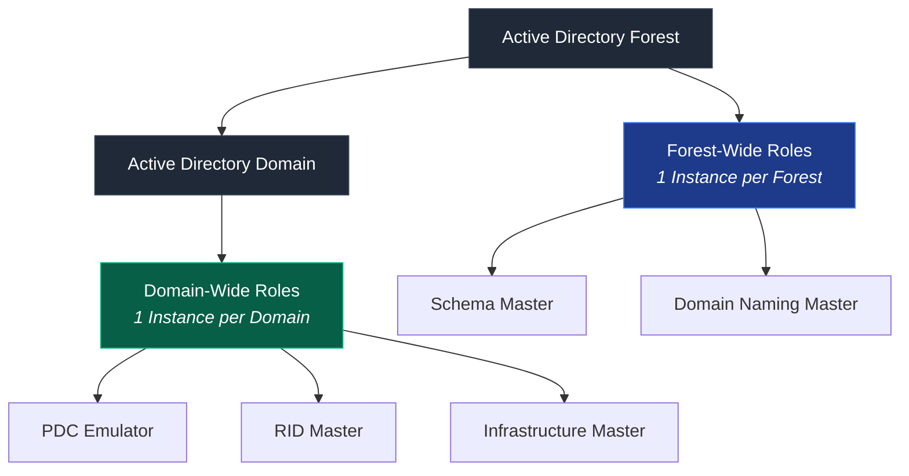
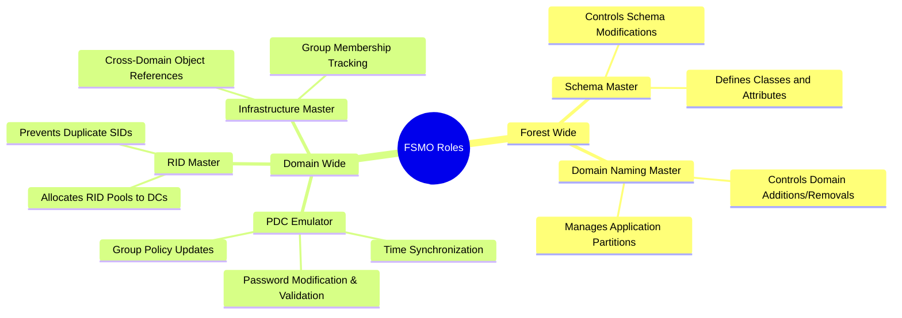
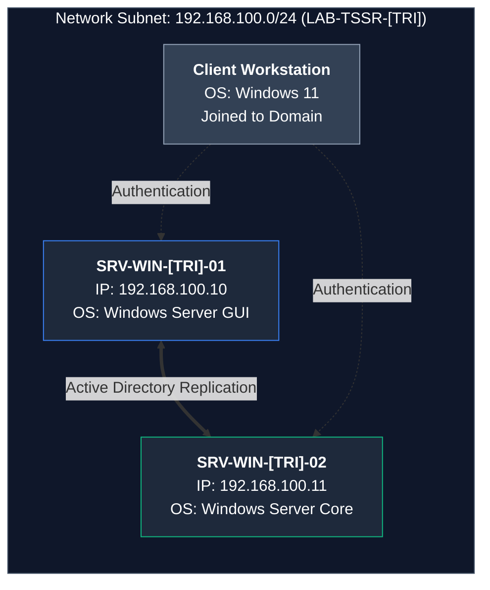

This guide covers the theory, verification, graphical transfer, and PowerShell transfer of Active Directory **FSMO** (Flexible Single Master Operations) roles between Domain Controllers (DCs).

## 1. Theoretical Background & Core Concepts

### What are FSMO Roles?

Active Directory Domain Services (AD DS) primarily operates on a **multi-master replication model**: any Domain Controller can process writes (such as creating users or changing passwords) and replicate those changes to all other DCs.

However, certain critical operations require strict consistency to prevent conflicts across the entire directory or forest. Active Directory handles these tasks using a **single-master model**, where specific operations can only be performed by a single DC designated as the **FSMO Role Owner**.

There are **5 FSMO roles** divided into two scope categories:



---

### Forest vs. Domain Role Scope Breakdown



---

### The 5 FSMO Roles Explained

#### Forest-Wide Roles (Only one instance per AD Forest)

1. **Schema Master**:
   * **Function**: Controls all updates and modifications to the Active Directory **Schema** (the structural definition of all object classes and attributes, such as `user`, `group`, `computer`).
   * **Why single-master?**: Schema changes modify the structural foundation of the entire forest. Allowing concurrent schema edits from multiple sources could cause catastrophic database corruption.

2. **Domain Naming Master**:
   * **Function**: Controls the addition, renaming, or removal of domains, partitions, and application partitions within the forest.
   * **Why single-master?**: Ensures that domain names remain unique across the entire enterprise directory structure.

#### Domain-Wide Roles (One instance per Active Directory Domain)

3. **PDC Emulator (Primary Domain Controller Emulator)**:
   * **Function**:
     * Acts as the authoritative **time server** for the domain (Windows Time Service / NTP hierarchy).
     * Processes password changes immediately and acts as the fallback server when authentication fails on another DC due to a recent password change.
     * Processes Account Lockout policies.
     * Serves as the primary target for Group Policy Object (GPO) updates.
   * **Why single-master?**: Eliminates race conditions for password updates and ensures time synchronization across network entities (Kerberos authentication strictly requires time skew within 5 minutes).

4. **RID Master (Relative Identifier Master)**:
   * **Function**: Allocates pools of unique Security Identifiers (SIDs) / Relative Identifiers (RIDs) to each DC in the domain.
   * **Why single-master?**: Every security principal (user, group, computer) has a unique SID. To prevent two DCs from generating duplicate security IDs, DCs request a batch of RIDs (typically 500 at a time) exclusively from the RID Master.

5. **Infrastructure Master**:
   * **Function**: Responsible for updating references from objects in its own domain to objects in other domains (cross-domain object references, such as multi-domain group memberships).
   * **Note/Best Practice**: In a single-domain environment or when all DCs run as Global Catalog (GC) servers, the Infrastructure Master role has minimal overhead. Do **NOT** place the Infrastructure Master on a Global Catalog server in a multi-domain environment unless *all* DCs are Global Catalogs.

---

## 2. Lab Environment & Role Transfer Workflow

### Architecture Overview



### Lab Transfer Sequence Workflow

```mermaid
sequenceDiagram
    autonumber
    participant DC1 as SRV-WIN-[TRI]-01 (GUI)
    participant DC2 as SRV-WIN-[TRI]-02 (Core)

    Note over DC1,DC2: Initial State: All 5 FSMO Roles on DC1

    rect rgb(30, 58, 138)
    Note over DC1,DC2: Step 1: Graphical Transfer (GUI Consoles)
    DC1->>DC2: Transfer Domain Roles (dsa.msc) -> RID, PDC, Infra
    DC1->>DC2: Transfer Domain Naming Master (domain.msc)
    DC1->>DC2: Transfer Schema Master (schmmgmt.msc)
    end

    Note over DC1,DC2: Intermediate State: All 5 FSMO Roles on DC2

    rect rgb(6, 95, 70)
    Note over DC1,DC2: Step 2: PowerShell Transfer
    DC2->>DC1: Move-ADDirectoryServerOperationMasterRole (0,1,2,3,4)
    end

    Note over DC1,DC2: Final State: All 5 FSMO Roles Returned to DC1
```



| Variable | Description | 
| ----- | ----- | 
| **Domain Name** | `TSSR-[TRI].LAB` (e.g., `TSSR-XYZ.LAB`) | 
| **Subnet / Network** | `192.168.100.0/24` (`LAB-TSSR-[TRI]`) | 
| **DC 1 (GUI)** | `SRV-WIN-[TRI]-01` (`192.168.100.10`) — Windows Server Desktop Experience | 
| **DC 2 (Core)** | `SRV-WIN-[TRI]-02` (`192.168.100.11`) — Windows Server Core | 
| **Client Workstation** | Windows 11 Workstation joined to domain | 

> **Note**: Replace `[TRI]` with your designated 3-letter identifier or trigram (e.g., `SRV-WIN-JDOE-01`).

---

## 3. Step 1: Identifying Current FSMO Role Owners & Health Checks

Before performing any role transfers, confirm current role holders and verify Active Directory health.

### Step 1.1: Identify FSMO Holders via Command Line

Run the following command in PowerShell or Command Prompt on `SRV-WIN-[TRI]-01`:

```cmd
netdom query fsmo
```

**Expected Output:**

```text
Schema master               SRV-WIN-[TRI]-01.tssr-[tri].lab
Domain naming master        SRV-WIN-[TRI]-01.tssr-[tri].lab
PDC                         SRV-WIN-[TRI]-01.tssr-[tri].lab
RID pool manager            SRV-WIN-[TRI]-01.tssr-[tri].lab
Infrastructure master       SRV-WIN-[TRI]-01.tssr-[tri].lab
The command completed successfully.
```

### Step 1.2: Check Domain Controller Availability & Replication

Verify AD replication state and network connectivity before modifying role holders:

```powershell
# Verify domain controllers status
Get-ADDomainController -Filter * | Select-Object Name, IPv4Address, OperatingSystem

# Check Active Directory replication health
repadmin /replsummary
repadmin /showrepl
```

Ensure `repadmin /replsummary` shows `0` errors across all nodes.

---

## 4. Step 2: Transferring FSMO Roles Using Graphical Consoles (GUI)

We will transfer all 5 roles from `SRV-WIN-[TRI]-01` to `SRV-WIN-[TRI]-02` using administrative consoles.

### 4.1 Domain-Wide Roles (RID, PDC, Infrastructure)

**Console**: Active Directory Users and Computers (`dsa.msc`)

1. Open **Active Directory Users and Computers**.
2. Right-click the domain node (`TSSR-[TRI].LAB`) in the left pane and select **Change Domain Controller...**
3. Select `SRV-WIN-[TRI]-02.tssr-[tri].lab` and click **OK**.
4. Right-click the domain node again and select **Operations Masters...**
5. Navigate through the tabs and click **Change** on each:
   * **RID Tab**: Click **Change** $\rightarrow$ Confirm transfer.
   * **PDC Tab**: Click **Change** $\rightarrow$ Confirm transfer.
   * **Infrastructure Tab**: Click **Change** $\rightarrow$ Confirm transfer.

### 4.2 Domain Naming Master Role

**Console**: Active Directory Domains and Trusts (`domain.msc`)

1. Open **Active Directory Domains and Trusts**.
2. Right-click the top node **Active Directory Domains and Trusts** in the left tree and select **Change Active Directory Domain Controller...**
3. Choose `SRV-WIN-[TRI]-02.tssr-[tri].lab` and click **OK**.
4. Right-click **Active Directory Domains and Trusts** again and select **Operations Master...**
5. Click **Change** to transfer the Domain Naming Master role to `SRV-WIN-[TRI]-02`.

### 4.3 Schema Master Role

**Console**: Active Directory Schema snap-in (`schmmgmt.msc`)

> **Note**: The Active Directory Schema MMC snap-in is unregistered by default to prevent unintended schema changes.

1. Register the dynamic-link library via an elevated Command Prompt or PowerShell:

   ```powershell
   regsvr32 schmmgmt.dll
   ```

   *Verify the popup message confirms successful registration.*

2. Open an empty Microsoft Management Console:
   * Press `Win + R`, type `mmc.exe`, and press **Enter**.

3. In MMC: Go to **File** $\rightarrow$ **Add/Remove Snap-in...**
4. Select **Active Directory Schema** $\rightarrow$ Click **Add** $\rightarrow$ Click **OK**.
5. Right-click **Active Directory Schema** in the tree and select **Change Active Directory Domain Controller...**
6. Select `SRV-WIN-[TRI]-02.tssr-[tri].lab` and click **OK** (acknowledge any warning about schema editing).
7. Right-click **Active Directory Schema** and select **Operations Master...**
8. Click **Change** to transfer the Schema Master role to `SRV-WIN-[TRI]-02`.

### 4.4 Verification of Graphical Transfer

Run from PowerShell:

```powershell
netdom query fsmo
```

All 5 roles should now point to `SRV-WIN-[TRI]-02`.

---

## 5. Step 3: Transferring FSMO Roles Using PowerShell

Now we will perform the reverse operation: moving all 5 roles back from `SRV-WIN-[TRI]-02` (Server Core) to `SRV-WIN-[TRI]-01` using PowerShell.

### 5.1 Identify Active Directory PowerShell Module

The standard module for managing Active Directory is `ActiveDirectory`, included with RSAT and installed on Domain Controllers by default.

### 5.2 PowerShell Commands to Check FSMO Holders

```powershell
# Get Domain-wide FSMO roles
(Get-ADDomain).PDCEmulator
(Get-ADDomain).RIDMaster
(Get-ADDomain).InfrastructureMaster

# Get Forest-wide FSMO roles
(Get-ADForest).SchemaMaster
(Get-ADForest).DomainNamingMaster
```

### 5.3 Move All 5 FSMO Roles to `SRV-WIN-[TRI]-01`

The `Move-ADDirectoryServerOperationMasterRole` cmdlet can transfer multiple or all roles in a single execution.

```powershell
# Execute targeting SRV-WIN-[TRI]-01
Move-ADDirectoryServerOperationMasterRole -Identity "SRV-WIN-[TRI]-01" -OperationMasterRole 0,1,2,3,4 -Confirm:$false
```

#### Parameter Role Numerical Index Reference:

* `0`: **PDCEmulator**
* `1`: **RIDMaster**
* `2`: **InfrastructureMaster**
* `3`: **SchemaMaster**
* `4`: **DomainNamingMaster**

*Alternative syntax using named constants:*

```powershell
Move-ADDirectoryServerOperationMasterRole -Identity "SRV-WIN-[TRI]-01" `
  -OperationMasterRole PDCEmulator, RIDMaster, InfrastructureMaster, SchemaMaster, DomainNamingMaster `
  -Confirm:$false
```

### 5.4 Verify PowerShell Role Transfer

```powershell
Get-ADDomain | Select-Object PDCEmulator, RIDMaster, InfrastructureMaster
Get-ADForest | Select-Object SchemaMaster, DomainNamingMaster
```

---

## 6. Step 4: Post-Transfer Active Directory Validation

Validate AD health, replication, and client processing following role transfers.

1. **Verify Availability of Both DCs**:

   ```powershell
   Test-Connection -ComputerName "SRV-WIN-[TRI]-01" -Count 2
   Test-Connection -ComputerName "SRV-WIN-[TRI]-02" -Count 2
   ```

2. **Force and Verify AD Replication**:

   ```powershell
   repadmin /syncall /A /e /d
   repadmin /replsummary
   ```

3. **Verify User Authentication**:
   Log into a domain-joined Windows 11 client using a domain user account (e.g., `TSSR-[TRI]\jdoe`) and verify domain logon:

   ```cmd
   whoami /fqdn
   echo %LOGONSERVER%
   ```

4. **Replication Object Test**:

   * Create a temporary user on `SRV-WIN-[TRI]-01`:

     ```powershell
     New-ADUser -Name "Test Replication" -SamAccountName "test.repl" -UserPrincipalName "test.repl@tssr-[tri].lab" -Enabled $true
     ```

   * Query the user from `SRV-WIN-[TRI]-02` to confirm real-time replication:

     ```powershell
     Get-ADUser -Server "SRV-WIN-[TRI]-02" -Identity "test.repl"
     ```

   * Clean up test user:

     ```powershell
     Remove-ADUser -Identity "test.repl" -Confirm:$false
     ```

---

## 7. Answers to Comprehension Questions

### Q1: Why can users continue to authenticate when a DC holding FSMO roles is offline?

**Answer**:
User authentication in Active Directory relies on the Kerberos v5 protocol (or NTLM fallback) and Global Catalog lookups. Standard authentication can be processed by **any functional Domain Controller** in the domain because user account database records and password hashes are replicated multi-master across all DCs. FSMO roles manage specific structural and administrative operations, not daily authentication operations.

### Q2: Which of the 5 FSMO roles plays a key role in managing recent password changes?

**Answer**:
The **PDC Emulator**. When a user changes their password, the update is immediately sent to the PDC Emulator over an urgent replication pathway. If a user tries to log in to another DC before normal replication finishes, that DC forwards the request to the PDC Emulator to check if a new password exists before rejecting the attempt.

### Q3: Why must you check Active Directory replication before transferring an FSMO role?

**Answer**:
Transferring a role assumes the source and target DCs have matching Active Directory data. If replication is broken or delayed, transferring a role (like Schema or RID Master) can cause inconsistent state updates, database synchronization errors, or duplicate Object/RID allocations.

### Q4: In what scenario would a forced seizure of FSMO roles be necessary?

**Answer**:
A **Role Seizure** (using `Move-ADDirectoryServerOperationMasterRole -Force` or `ntdsutil`) is required only when the original FSMO role holder suffers an unrecoverable hardware/software failure, is permanently destroyed, or is offline without possibility of recovery.

> **CRITICAL WARNING**: Never bring a Domain Controller back online if its FSMO roles were seized by another DC. Doing so causes USN rollback and directory database corruption. The seized DC must be forcibly removed from AD and rebuilt from scratch.

---

## 8. Validation Checklist

* \[x\] All 5 FSMO roles identified using `netdom query fsmo` and AD PowerShell modules.
* \[x\] Registered `schmmgmt.dll` and accessed the AD Schema MMC Console.
* \[x\] Successfully transferred all 5 FSMO roles to Server Core (`SRV-WIN-[TRI]-02`) using GUI consoles.
* \[x\] Successfully transferred all 5 FSMO roles back to `SRV-WIN-[TRI]-01` using PowerShell commands.
* \[x\] Confirmed AD replication status using `repadmin`.
* \[x\] Verified domain authentication and object replication.